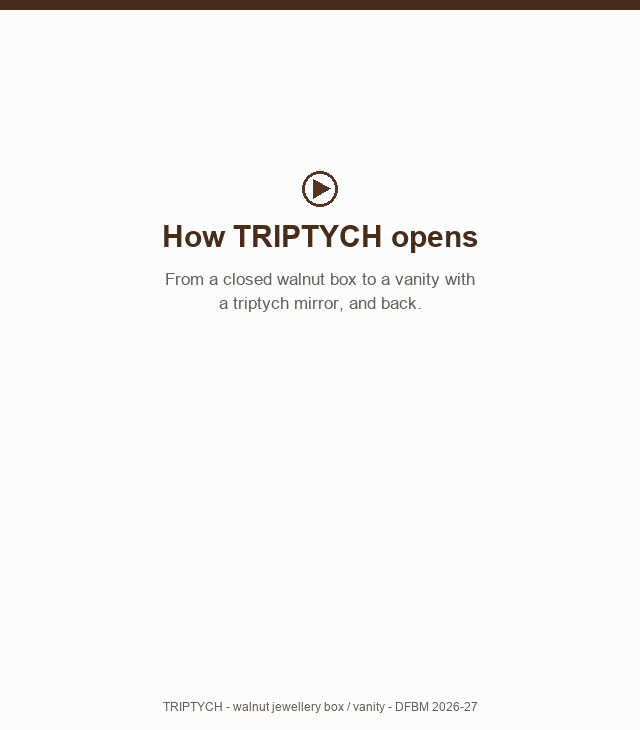
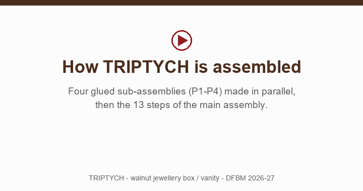
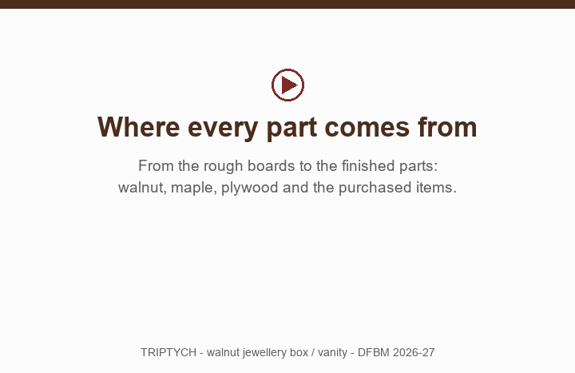

# TRIPTYCH – walnut jewellery box / vanity

Animations of the individual project for *Design and Manufacturing Based on Assembly* (2026-27).
All of them were made inside CATIA V5 with the real 3D parts of the box.

## ▶ How it opens

## ▶ How it is assembled

## ▶ Where every part comes from

## Direct manufacturing cost
[JB_Cost_estimate.xlsx](JB_Cost_estimate.xlsx): materials with yields, purchased parts, operations and times (series of 500/year, batches of 50). Rates, prices and times are estimates; sources in the report bibliography.
